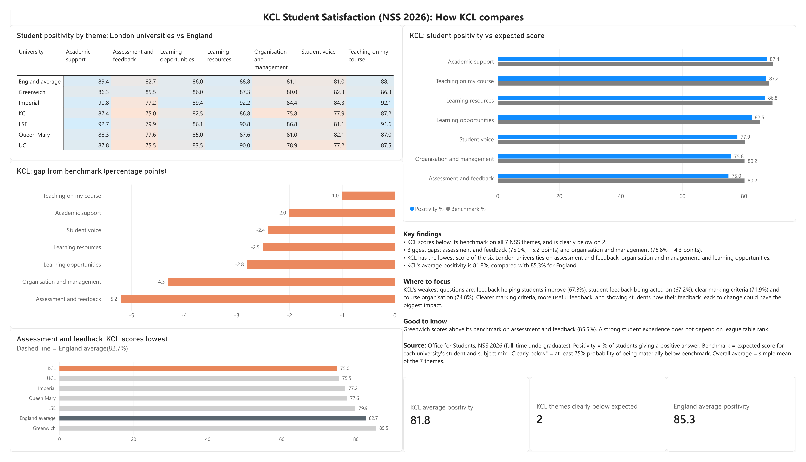

# KCL Student Satisfaction: NSS 2026 Power BI Dashboard

**Question:** Where does King's College London perform best and worst for student satisfaction, compared with other London universities and the England average?



## Key findings
- **Below expected on every theme.** KCL scores below its benchmark on all 7 NSS themes, and is clearly below on 2.
- **Biggest gaps:** assessment and feedback (75.0%, −5.2 points below benchmark) and organisation and management (75.8%, −4.3 points).
- **Lowest in the London group.** Of the six London universities compared, KCL has the lowest score on assessment and feedback, organisation and management, and learning opportunities.
- **Overall:** KCL's average positivity across the 7 themes is 81.8%, compared with 85.3% for England.
- **Where to focus:** KCL's weakest questions are about feedback helping students improve (67.3%), student feedback being acted on (67.2%), clear marking criteria (71.9%) and course organisation (74.8%).
- **League table rank is not the same as student experience.** Greenwich is ranked much lower in league tables, yet it scores above its benchmark on assessment and feedback (85.5%).

## Data
- **Source:** Office for Students, *National Student Survey 2026: results for full-time students at registering providers* (`NSS26_Summary_Registered_Full-time.xlsx`, sheet `All_subjects`). Published under the Open Government Licence.
- **Scope:** all undergraduates, full-time, all subjects combined.
- **Universities:** King's College London, University College London, Imperial College London, LSE, Queen Mary University of London, University of Greenwich, and England as the national average.

The raw data file is not included here. You can download it from the [OfS NSS data page](https://www.officeforstudents.org.uk/data-and-analysis/national-student-survey-data/download-the-nss-data/).

## Key terms
| Term | Meaning |
|---|---|
| Positivity (%) | Share of students who chose one of the two positive answers (options 1–2 of 4) |
| Benchmark (%) | The score expected for a university, given its mix of students and subjects |
| Difference (ppt) | Positivity minus benchmark. A negative value means worse than expected |
| Clearly below / above | At least a 75% probability of being materially below or above the benchmark. This threshold is my own choice, not an official OfS rule |
| Overall average | A simple mean of the 7 theme scores. It is not an official NSS measure and is not benchmark-adjusted |

## Data preparation (Power Query) and quality checks
1. Removed the title rows above the header, then promoted the real column names.
2. Filtered to the 6 universities plus England, with level of study set to "All undergraduates".
3. **Row count check:** 274 rows (40 per provider, but LSE has 34). The 6-row difference turned out to be the healthcare placement questions (HC1–HC6), which are only asked of NHS-funded healthcare students.
4. Removed the HC questions, since they are not comparable across all universities. This left **238 rows** (7 providers × 34 themes and questions).
5. Kept 9 of the 23 columns. I removed IDs, raw answer counts and technical columns.
6. Added helper columns:
   - **Type** (Theme or Question)
   - **Short name** (for example, "Theme 3: Assessment and feedback" becomes "Assessment and feedback")
   - **University** (short labels)
7. **Checks:**
   - England has no benchmark values. This is expected, because it is the national average.
   - Q28 (overall satisfaction) is not asked in England, so it does not appear in the data.
   - No results were suppressed for the selected providers.
   - I verified the positivity calculation against the raw answer counts. For the UK Q01, (122,412 + 185,224) ÷ 328,296 = 93.7%, which matches the published figure.

## Model and DAX
The model is a single table (`NSS`). The key measures are:
```DAX
Positivity % = AVERAGE(NSS[Positivity measure (%)])
Benchmark % = AVERAGE(NSS[Benchmark (%)])
Difference vs Benchmark = AVERAGE(NSS[Difference (ppt)])
England % = CALCULATE([Positivity %], NSS[University] = "England average")
KCL Themes Below Benchmark =
    COUNTROWS(FILTER(NSS, NSS[University] = "KCL" && NSS[Type] = "Theme"
        && NSS[Benchmark status] = "Materially below"))
```

## Limitations
- The NSS covers final-year undergraduates only. Postgraduate and online students are not included.
- It measures student opinion, not teaching quality directly.
- These are single-year results from 2026, so I cannot show a trend yet.
- Benchmarks adjust for student and subject mix, but not for differences in student expectations between universities.

## Tools
Power BI Desktop (Power Query, DAX, conditional formatting) and Excel.

*Author: Zufishaa Ayub*
